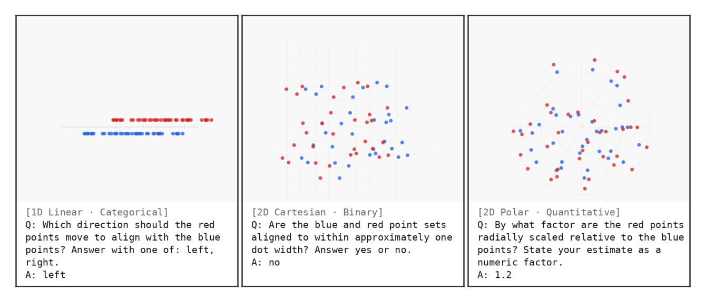
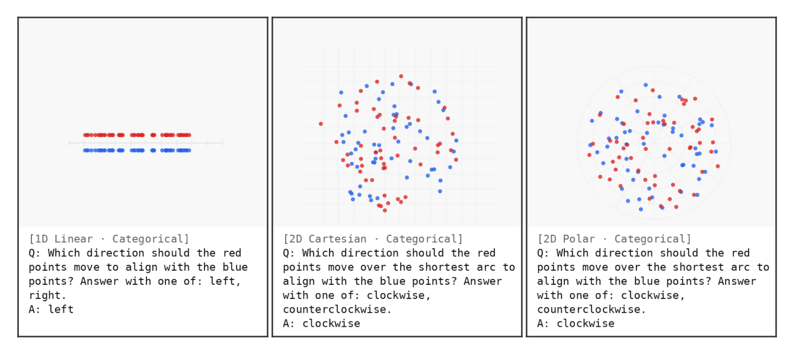

# Sophon

A procedurally-generated benchmark for diagnosing spatial reasoning failure modes in Vision-Language Models.

Sophon ships **no images** — it ships a generator. A YAML spec plus an integer seed deterministically produces `(image, question, ground_truth)` triples, so every experiment is reproducible from a one-line config. The benchmark strips everything except spatial structure: no objects, no scenes, no textures, no language cues. What's left is a clean readout on whether a VLM can recover a geometric transformation from its rendered projection.



> *Sample Sophon stimuli, one per (coordinate-system, question-type) cell. Left: 1D-linear / categorical. Center: 2D Cartesian / binary. Right: 2D polar / quantitative. Each panel shows its coordinate system and ground-truth transform parameter.*

## Quick start

```bash
# from the repo root, with uv installed
uv sync

# Render and preview a spec (writes images + question text to ./preview/<spec>/)
uv run sophon preview --spec sophon/specs/cartesian_rotation.yaml --num-samples 5

# Or generate (image, question, ground_truth) triples programmatically
uv run python -c "
from sophon.generator import BenchmarkGenerator
from sophon.schema import BenchmarkSpec
import yaml

spec = BenchmarkSpec(**yaml.safe_load(open('sophon/specs/cartesian_rotation.yaml')))
for img, sample in BenchmarkGenerator(spec).generate(seed=42):
    print(sample.question_text, '->', sample.ground_truth)
    if img: img.save(f'sample_{sample.sample_id}.png')
"
```

## What's in the box

### Coordinate systems

- **1D Linear** — points on a number line; translation only.
- **2D Cartesian** — points on an x/y grid; translation, rotation, scale.
- **2D Polar** — points in (r, θ) space; radial shift, angular rotation, radial scale.

### Question types

- **Binary** — *"Are the blue and red point sets aligned (yes/no)?"* — single-token answer.
- **Categorical** — *"Which direction should the red points move to align with the blue points?"* — restricted (transform-relevant) or full (six-way) vocabulary.
- **Comparative** — *"Which image (A or B) shows better alignment?"* — pairwise side-by-side.
- **Quantitative** — *"Approximately how many degrees was the rotation?"* — magnitude estimation.



### Specs

`sophon/specs/` contains pre-baked YAML specs for the diagnostic suite used in the SOPHON paper:

- `cartesian_translation_x.yaml` / `cartesian_translation_y.yaml` / `cartesian_rotation.yaml` / `cartesian_scale.yaml` / `cartesian_compound.yaml`
- `linear_translation.yaml`
- `polar_radial.yaml` / `polar_radial_scale.yaml` / `polar_rotation.yaml`
- `full_suite.yaml` — concatenation runner

Each spec is a single YAML file; copy and edit to define your own. Spec fields document themselves (see `sophon/schema.py` for the dataclass definition).

## Determinism

Every spec is deterministic given a seed: same seed in, same `(image, question, ground_truth)` stream out. The SOPHON paper uses this to keep training-data seeds (`100`+) disjoint from evaluation seeds (`42`, `43`, `44`) — no leakage between fine-tuning data and held-out test items.

## Restricted vocabulary

Categorical questions default to a **restricted** vocabulary — only the two direction words relevant to the active transform (e.g. `left, right` for x-translation). VLMs preferentially select rotation tokens (`clockwise`, `counterclockwise`) when they're available even on translation tasks; restricted vocabulary isolates spatial reasoning from answer-set confusion. The full six-way vocabulary remains available via `vocab_mode: full` in the spec for ablations.

## Citing

If you use Sophon in published work, please cite:

```bibtex
@inproceedings{gazak2026sophon,
  title     = {{Sophon}: A Procedural Diagnostic for Spatial Reasoning in Vision-Language Models},
  author    = {Gazak, J. Zachary and Swindle, Ryan and Fletcher, Justin},
  booktitle = {The Fortieth Annual Conference on Neural Information Processing Systems},
  year      = {2026},
  url       = {https://openreview.net/forum?id=OL7Mvsjyzg}
}
```

## License

MIT.
